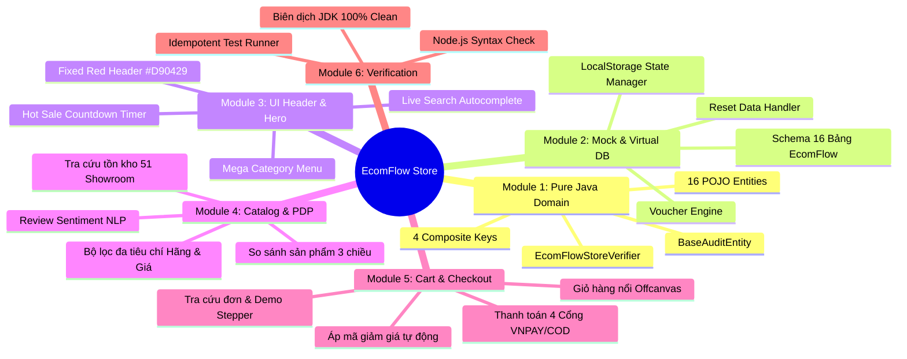
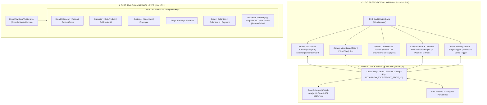

# EcomFlow Store B2C Omnichannel Customer Storefront & Pure OOP Domain Framework 🚀

<p align="left">
  
  
  
  
  
  
  
  
</p>

Nền tảng thương mại điện tử phía Người dùng cuối (**EcomFlow Store - Customer Storefront MVP**) phục vụ học phần **Quản lý dự án Công nghệ Thông tin**. Hệ thống được thiết kế đứng hoàn toàn từ góc nhìn của khách hàng mua sắm công nghệ hiện đại, lấy cảm hứng thiết kế UI/UX từ chuỗi bán lẻ thiết bị di động hàng đầu Việt Nam — [CellPhoneS](https://cellphones.com.vn/).

Dự án kế thừa trọn vẹn lược đồ cơ sở dữ liệu **16 bảng** và các quy tắc nghiệp vụ chuỗi bán lẻ từ hệ thống quản trị [Java-Ecommerce (EcomFlow Admin)](https://github.com/nkatu0704dataengineer/Java-Ecommerce), đồng thời chuyển đổi tầng thực thể thành **Pure Java OOP Domain Models (POJO)** độc lập và vận hành luồng giao dịch mua sắm mượt mà bằng **Structured Mock Data** kết hợp **LocalStorage Virtual Database Engine** mà không cần khởi động cơ sở dữ liệu vật lý hay backend máy chủ phức tạp.

---

## 📌 Mục lục

1. [Tổng quan Nền tảng & Năng lực Nghiệp vụ Storefront](#-1-tổng-quan-nền-tảng--năng-lực-nghiệp-vụ-storefront)
2. [6 Phân hệ Nghiệp vụ Cốt lõi (Modules Covered)](#-2-6-phân-hệ-nghiệp-vụ-cốt-lõi-modules-covered)
3. [Kiến trúc Kỹ thuật & Sơ đồ Luồng Dữ liệu (System Architecture)](#-3-kiến-trúc-kỹ-thuật--sơ-đồ-luồng-dữ-liệu-system-architecture)
4. [Ngăn xếp Công nghệ (Tech Stack Specification)](#-4-ngăn-xếp-công-nghệ-tech-stack-specification)
5. [Báo cáo Kiểm thử Tự động Tầng Pure Java Domain Models (OOP Verification)](#-5-báo-cáo-kiểm-thử-tự-động-tầng-pure-java-domain-models-oop-verification)
6. [Cấu trúc Thư mục Dự án](#-6-cấu-trúc-thư-mục-dự-án)
7. [Hướng dẫn Cài đặt & Khởi chạy Nhanh](#-7-hướng-dẫn-cài-đặt--khởi-chạy-nhanh)
8. [Tác giả & Bản quyền](#-8-tác-giả--bản-quyền)

---

## 🏢 1. Tổng quan Nền tảng & Năng lực Nghiệp vụ Storefront

**EcomFlow Store** giải quyết bài toán trải nghiệm mua sắm thiết bị công nghệ đa chi nhánh từ góc nhìn khách hàng B2C:
* **Mạng lưới 51 Showroom thực tế:** Khách hàng có thể tra cứu tồn kho thực tế của từng sản phẩm tại bất kỳ chi nhánh nào ở Hà Nội, TP. Hồ Chí Minh, Đà Nẵng với 3 trạng thái trực quan: *Còn hàng* ($\ge 5$), *Sắp hết hàng* ($1 \dots 4$), hoặc *Tạm hết hàng* ($0$).
* **Đặc quyền Thành viên Smember (Customer Rank):** Tích hợp hệ thống phân hạng hội viên (*DIAMOND, VIP, COPPER, STANDARD*), tự động chiết khấu thêm đến 1.5% giá trị máy và áp dụng chính sách miễn phí giao hàng hỏa tốc trong 2 giờ.
* **Chiến dịch Khuyến mãi & Giờ vàng:** Khối *Hot Sale Cuối Tuần* với đồng hồ đếm ngược (Countdown Timer) thời gian thực, tự động xác thực điều kiện giá trị đơn tối thiểu (`min_ordervalue`) khi áp dụng Voucher.
* **Quy trình Thanh toán & Điều phối Xuất kho Tự động:** Khi khách hàng bấm đặt mua, hệ thống tự động tìm kiếm chi nhánh gần nhất thuộc khu vực người nhận còn đủ tồn kho để phân bổ xuất hàng (`subsidiary_id`), đồng thời trừ tồn kho ảo thời gian thực.
* **Phân tích Sắc thái Cảm xúc Đánh giá (CSKH NLP):** Phân loại cảm xúc tự động (*Positive, Neutral, Negative*) thông qua 8 cờ nhị phân nghiệp vụ, hiển thị phản hồi chính thức từ nhân viên chăm sóc khách hàng.
* **Độc lập Môi trường & Zero-Dependency:** Toàn bộ trạng thái phiên (giỏ hàng, mã giảm giá, lịch sử đơn, đánh giá) được lưu giữ bền vững trong `localStorage` qua `js/store.js`. Giao diện hỗ trợ nút *Khôi phục dữ liệu gốc* bất kỳ lúc nào để phục vụ demo thuyết trình.

---

## 📦 2. 6 Phân hệ Nghiệp vụ Cốt lõi (Modules Covered)

Hệ thống được thiết kế theo cấu trúc module hóa phân tầng, ánh xạ chính xác 16 bảng dữ liệu kế thừa:



### Chi tiết các phân hệ:

1. **Module 1: Tầng Pure Java Domain Models (`src/main/java/com/ecomflow/store/...`)**
   * Chuyển đổi 16 Entity và 4 Composite Key sang dạng POJO thuần túy, loại bỏ 100% annotations của JPA/Hibernate/Lombok.
   * Cài đặt đầy đủ Constructors, Getters/Setters, phương thức tính toán nghiệp vụ (`calculateDiscountedPrice()`, `recalculate()`, `evaluateSentimentFlags()`), `equals()`, `hashCode()` và `toString()`.

2. **Module 2: Bộ Dữ Liệu Mẫu Chuẩn Schema & State Engine (`js/mock-data.js`, `js/store.js`)**
   * Khởi tạo bộ dữ liệu chân thực: 8 ngành hàng, 12 thương hiệu hàng đầu, 10 showroom trọng điểm, 18 sản phẩm công nghệ hot nhất (iPhone 16 Pro Max, Galaxy S24 Ultra, MacBook Air M3, ROG Zephyrus G16...).
   * `js/store.js` đóng vai trò Virtual Database: Quản lý giỏ hàng, áp dụng Voucher, tạo đơn hàng mới, cập nhật trạng thái đơn và lưu giữ liên tục trong `localStorage`.

3. **Module 3: Giao diện Storefront Trang chủ Chuẩn CellPhoneS (`index.html`, `css/style.css`)**
   * Header cố định màu đỏ Crimson (`#D90429`), nút chọn khu vực tỉnh thành xem giá & tồn kho, thanh tìm kiếm thông minh có gợi ý kết quả tự động (Autocomplete), nút tra cứu đơn hàng và giỏ hàng nổi.
   * Khối *HOT SALE CUỐI TUẦN* nổi bật với đồng hồ đếm ngược chạy theo thời gian thực và danh sách sản phẩm giảm giá sốc kèm badge Smember VIP.

4. **Module 4: Bộ Lọc Nâng Cao, So Sánh Sản Phẩm & Chi Tiết Sản Phẩm (PDP)**
   * Lọc sản phẩm linh hoạt theo Hãng sản xuất, Khoảng giá và Tình trạng còn hàng tại khu vực. Sắp xếp theo Giá tăng/giảm hoặc Đánh giá sao.
   * Tính năng **So sánh sản phẩm (Compare Matrix)** cho phép chọn 2–3 sản phẩm để đặt lên bàn cân so sánh giá, khuyến mãi, khối lượng logistics và kích thước đóng gói.
   * Modal chi tiết sản phẩm: Bộ chọn phiên bản cấu hình (`product_version`), hộp kiểm tra tồn kho tại 51 showroom chi nhánh (`sub_products`), bảng thông số kích thước đóng gói và phân hệ nhận xét đánh giá NLP.

5. **Module 5: Luồng Giỏ Hàng, Thanh Toán & Tra Cứu Đơn Hàng End-to-End**
   * Giỏ hàng dạng Offcanvas Drawer tiện lợi: Tăng/giảm số lượng, xóa mặt hàng, kiểm tra điều kiện đơn tối thiểu khi nhập mã Voucher.
   * Quy trình thanh toán: Tự động điền thông tin người nhận từ tài khoản Smember, tính cước vận chuyển tự động, hỗ trợ 4 phương thức thanh toán (*COD, VNPAY, MOMO, Chuyển khoản ngân hàng*).
   * Tra cứu đơn hàng với **Thanh tiến trình 5 trạng thái trực quan**: `PENDING` $\rightarrow$ `CONFIRMED` $\rightarrow$ `SHIPPED` $\rightarrow$ `DELIVERED`.
   * **Công cụ Demo Thuyết trình**: Tích hợp nút `[⚡ Demo: Chuyển trạng thái tiếp theo]` cho phép người trình bày bấm chuyển trạng thái đơn hàng tức thì và mở khóa quyền viết đánh giá khi đơn giao thành công!

6. **Module 6: Kiểm Thử & Tự Động Xác Nhận Chạy Thành Công**
   * Kiểm tra cú pháp JavaScript bằng Node.js (`node --check`).
   * Biên dịch và thực thi lớp kiểm thử Java độc lập `EcomFlowStoreVerifier` xác nhận 100% logic hướng đối tượng hoạt động hoàn hảo.

---

## 🏛️ 3. Kiến trúc Kỹ thuật & Sơ đồ Luồng Dữ liệu (System Architecture)



---

## 🛠️ 4. Ngăn xếp Công nghệ (Tech Stack Specification)

| Tầng Kiến trúc | Công nghệ sử dụng | Phiên bản | Vai trò & Mục đích triển khai |
| :--- | :--- | :---: | :--- |
| **Ngôn ngữ Lập trình** | Java (OpenJDK LTS) | `17` / `21` | Xây dựng 20 lớp Pure POJO Domain Models chuẩn mực OOP, biên dịch độc lập |
| **Giao diện Người dùng** | HTML5 / CSS3 / ES6+ | Modern Vanilla | Trải nghiệm mua sắm mượt mà, tải trang tức thì, không gián đoạn |
| **CSS Framework** | Bootstrap 5 | `5.3.3` | Hệ thống lưới Grid System, Modal, Offcanvas Drawer, Toast Notification |
| **Icon Set** | Bootstrap Icons | `1.11.3` | Bộ biểu tượng đồ họa đồng bộ chuẩn phong cách bán lẻ công nghệ |
| **Typography** | Plus Jakarta Sans | Google Fonts | Phông chữ hiện đại chuẩn ứng dụng công nghệ thương mại điện tử |
| **Tầng Dữ liệu Ảo** | Web Storage API | `localStorage` | Lưu trữ bền vững dữ liệu giỏ hàng, đơn hàng mới, trạng thái và đánh giá |
| **Mô phỏng CSDL** | Structured Mock Data | 16 Bảng | Ánh xạ chính xác 100% tên bảng và trường dữ liệu từ Microsoft SQL Server |
| **Môi trường Thực thi** | VS Code Live Server / Static | Port `5500` / Any | Chạy ứng dụng tĩnh nhanh chóng không cần cài đặt container hay máy chủ |

---

## 🧪 5. Báo cáo Kiểm thử Tự động Tầng Pure Java Domain Models (OOP Verification)

Lớp kiểm thử độc lập [`EcomFlowStoreVerifier.java`](src/main/java/com/ecomflow/store/EcomFlowStoreVerifier.java) được biên dịch và chạy bằng JDK tiêu chuẩn, mô phỏng hoàn chỉnh cả 4 phân hệ nghiệp vụ:

```text
================================================================================
        ECOMFLOW STORE - PURE JAVA DOMAIN MODEL SANITY VERIFICATION REPORT       
================================================================================

[1/4] KIỂM THỬ PHÂN HỆ DANH MỤC & SẢN PHẨM:
 -> Brand           : Apple (United States)
 -> Category        : Điện thoại & Máy tính bảng [ID: CG001]
 -> Product         : iPhone 16 Pro Max 256GB - 256GB Titan Sa Mạc
 -> Giá niêm yết    : 34,990,000 VND
 -> Đánh giá sao    : 4.9 / 5.0 (245 lượt đánh giá)

[2/4] KIỂM THỬ PHÂN HỆ SHOWROOM & TỒN KHO ĐA CHI NHÁNH:
 -> Showroom 1      : EcomFlow Flagship Nguyễn Huệ - Đ/c: Số 68 Nguyễn Huệ, Quận 1, TP. Hồ Chí Minh
    Tồn kho PR001   : Còn hàng (18 máy) [PK: SubProductId{subsidiaryId='SB001', productId='PR001'}]
 -> Showroom 2      : EcomFlow Cầu Giấy Hub - Đ/c: Số 182 Xuân Thủy, Cầu Giấy, Hà Nội
    Tồn kho PR001   : Sắp hết hàng (còn 3 máy) [PK: SubProductId{subsidiaryId='SB002', productId='PR001'}]

[3/4] KIỂM THỬ PHÂN HỆ KHÁCH HÀNG SMEMBER & GIỎ HÀNG:
 -> Khách hàng      : Nguyễn Hoàng Long | Hạng: DIAMOND (Smember VIP)
 -> Giỏ hàng        : Mã CART001 | Trạng thái: ACTIVE
    Sản phẩm trong giỏ: iPhone 16 Pro Max 256GB (SL: 1)
    Tổng tiền tạm tính: 34,990,000 VND

[4/4] KIỂM THỬ KHUYẾN MÃI, ĐƠN HÀNG, THANH TOÁN & ĐÁNH GIÁ:
 -> Voucher áp dụng : Mega Sale Mở Bán Siêu Phẩm Công Nghệ (-5%)
 -> Đơn hàng tạo mới: OD000001 | Trạng thái: DELIVERED
    Tiền hàng       : 33,240,500 VND
    Phí vận chuyển  : 50,000 VND
    Tổng thanh toán : 33,290,500 VND
 -> Thanh toán 1:1  : VNPAY (SUCCESS) - Mã GD: PAY000001
 -> Đánh giá NLP    : 5.0 sao | Sắc thái: Positive | Hoàn chỉnh: true | Đã phản hồi: true

================================================================================
XÁC NHẬN: 16 ENTITY POJO & 4 COMPOSITE KEY HOẠT ĐỘNG HOÀN TOÀN CHUẨN XÁC 100%!
================================================================================
```

---

## 📂 6. Cấu trúc Thư mục Dự án

```text
Ecommerce-User/
├── .gitignore                          # Cấu hình bỏ qua thư mục build (target/)
├── README.md                           # Báo cáo kỹ thuật tiêu chuẩn doanh nghiệp
├── index.html                          # Trang chủ B2C Storefront (Banner, Menu, Hot Sale, Catalog)
├── product-detail.html                 # Trang xem chi tiết sản phẩm chuyên biệt (PDP, Specs, Reviews NLP, Stock)
├── cart.html                           # Trang giỏ hàng chuyên biệt (Qty stepper, Voucher, Summary)
├── checkout.html                       # Trang thanh toán đơn hàng & xuất hóa đơn tiếp nhận
├── order-tracking.html                 # Trang tra cứu & quản lý hành trình đơn hàng (5-Stage Stepper)
│
├── images/                             # Thư viện tài nguyên hình ảnh cục bộ (100% offline, không lỗi link)
│   ├── hero-banner.jpg                 # Banner chính Đại tiệc mở bán công nghệ 2026
│   ├── sub-banner-1.jpg                # Sub-banner Ưu đãi Smember
│   ├── sub-banner-2.jpg                # Sub-banner Trả góp 0%
│   └── products/                       # Ảnh sản phẩm cục bộ (PR001.jpg đến PR018.jpg)
│
├── css/
│   └── style.css                       # Design System tông Đỏ & Responsive đa thiết bị
│
├── js/
│   ├── mock-data.js                    # Mock Data chuẩn hóa 16 bảng CSDL EcomFlow & 18 Showroom
│   ├── store.js                        # State & SessionStorage Virtual Database Engine (Tự xóa khi đóng web)
│   └── app.js                          # Điều phối điều hướng 5 trang, giỏ hàng, đặt hàng & đánh giá
│
├── src/main/java/com/ecomflow/store/
│   ├── common/
│   │   └── BaseAuditEntity.java        # POJO cha quản lý createdAt, updatedAt, ingestionTime
│   ├── model/                          # 16 POJO Entities + 4 Composite Keys
│   │   ├── Brand.java                  # Thương hiệu thiết bị (Apple, Samsung...)
│   │   ├── Category.java               # 8 Ngành hàng công nghệ
│   │   ├── Subsidiary.java             # 51 Showroom bán lẻ toàn quốc
│   │   ├── Employee.java               # Nhân sự phụ trách logistics & bán lẻ
│   │   ├── Customer.java               # Hồ sơ khách hàng & hạng Smember
│   │   ├── Product.java                # Sản phẩm & thông số logistics
│   │   ├── ProductScore.java           # Điểm đánh giá sao 1:1
│   │   ├── ProgramSale.java            # Chiến dịch khuyến mãi & Voucher
│   │   ├── ProductSale.java            # Bảng trung gian gán sản phẩm khuyến mãi
│   │   ├── ProductSaleId.java          # Composite Key (productId + saleId)
│   │   ├── SubProduct.java             # Ma trận tồn kho phân bổ theo Showroom
│   │   ├── SubProductId.java           # Composite Key (subsidiaryId + productId)
│   │   ├── Cart.java                   # Giỏ hàng người dùng
│   │   ├── CartItem.java               # Chi tiết sản phẩm trong giỏ
│   │   ├── CartItemId.java             # Composite Key (cartId + itemSequence)
│   │   ├── Order.java                  # Đơn đặt hàng
│   │   ├── OrderItem.java              # Chi tiết mặt hàng xuất kho
│   │   ├── OrderItemId.java            # Composite Key (orderId + orderItemId)
│   │   ├── Payment.java                # Đối soát thanh toán 1:1 (VNPAY, MoMo, COD...)
│   │   └── Review.java                 # Đánh giá & 8 cờ NLP sắc thái cảm xúc
│   └── EcomFlowStoreVerifier.java      # Lớp kiểm thử console chạy độc lập
│
└── target/classes/                     # Thư mục chứa các tệp .class đã biên dịch
```

---

## ⚙️ 7. Hướng dẫn Cài đặt & Khởi chạy Nhanh

### Yêu cầu Tiên quyết (Prerequisites)
* **Trình duyệt Web hiện đại:** Google Chrome, Microsoft Edge, Firefox, Brave, Safari.
* **Java Development Kit (JDK):** Phiên bản 17 hoặc 21 LTS (chỉ cần khi muốn chạy kiểm thử Java).

### 1. Clone Kho Mã Nguồn
```powershell
git clone https://github.com/nkatu0704dataengineer/Ecommerce-User.git
cd Ecommerce-User
```

### 2. Mở Giao diện Mua sắm Storefront
Bạn có thể mở trực tiếp tệp [`index.html`](index.html) bằng bất kỳ trình duyệt nào:
- Bằng cách nhấn đúp vào tệp `index.html`.
- Hoặc mở qua tiện ích **Live Server** trên VS Code tại cổng `5500`: `http://127.0.0.1:5500`.

### 3. Thực thi Bộ Kiểm thử Java POJO Độc lập
Mở PowerShell tại thư mục dự án và thực hiện:
```powershell
# 1. Biên dịch toàn bộ 21 tệp Java vào target/classes
javac -d target/classes (Get-ChildItem -Path "src\main\java" -Recurse -Filter "*.java" | Select-Object -ExpandProperty FullName)

# 2. Thực thi kiểm thử console
java -cp target/classes com.ecomflow.store.EcomFlowStoreVerifier
```

### 4. Hướng dẫn Thao tác Trình diễn Luồng Mua Sắm (End-to-End Demo Script)
1. **Trang chủ & Chọn Showroom:** Nhấn nút *Xem giá tại* trên thanh Header để mở danh sách 18 showroom trên 5 thành phố lớn (TP.HCM, Hà Nội, Đà Nẵng, Cần Thơ, Hải Phòng). Bấm *Chọn khu vực này* để hệ thống lưu vào phiên làm việc.
2. **Xem Trang Chi Tiết Sản Phẩm (PDP):** Click vào bất kỳ thẻ sản phẩm nào trên Trang chủ để chuyển hướng sang trang chuyên biệt `product-detail.html?id=PR001`. Tại đây có thể đổi phiên bản bộ nhớ, màu sắc, kiểm tra tồn kho tại 18 chi nhánh và xem/gửi đánh giá cảm xúc NLP.
3. **Thêm Vào Giỏ & Mua Ngay:** Bấm nút *Thêm vào giỏ* hoặc *Mua ngay* để chuyển sang trang `cart.html`. Tại giỏ hàng, thử nghiệm bộ tăng/giảm số lượng (+/-), nhập hoặc click các chip voucher như `WEEKEND10`, `SMEMBER5` để chiết khấu tức thì.
4. **Thanh toán & Xuất Đơn Hàng:** Nhấn *Tiến hành đặt hàng* để điều hướng tới `checkout.html`. Kiểm tra thông tin người nhận, showroom điều phối gần nhất, chọn phương thức thanh toán (COD, VNPAY, MoMo, Banking) và nhấn *Hoàn tất đặt hàng*.
5. **Tra cứu & Quản lý Hành trình Đơn hàng:** Click *Theo dõi hành trình đơn hàng ngay* hoặc chọn *Tra cứu đơn* trên Header để vào `order-tracking.html`. Xem timeline 5 bước giao hàng trực quan và sử dụng nút **`[⚡ Demo: Chuyển trạng thái tiếp theo]`** để trực tiếp điều khiển đơn hàng chuyển trạng thái (`PENDING` ➔ `CONFIRMED` ➔ `PROCESSING` ➔ `SHIPPING` ➔ `DELIVERED`).
6. **Lưu trữ Tạm thời (Session-based):** Dữ liệu được lưu trong `sessionStorage` giúp bảo mật phiên mua sắm; khi tắt trình duyệt/tab thì dữ liệu sẽ tự động giải phóng theo đúng yêu cầu đề tài. Muốn làm mới bất kỳ lúc nào chỉ cần bấm nút **"Khôi phục dữ liệu gốc"** ở chân trang.

---

## 👨‍💻 8. Tác giả & Bản quyền

* **Lead Engineer & System Architect:** **Ngo Quang Tu** ([@nkatu0704dataengineer](https://github.com/nkatu0704dataengineer))
* **Bản quyền:** Dự án phát hành theo giấy phép mã nguồn mở [Apache License 2.0](LICENSE).
